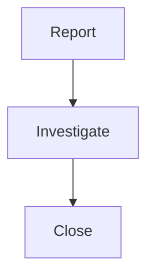
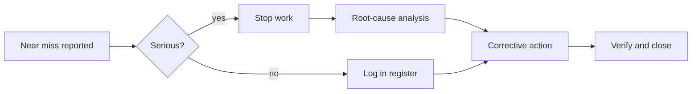

# Quarterly Site Safety Report

North Harbour Housing Block — Q3 2026

## Summary

The site recorded no lost-time incidents this quarter. Two near misses were reported, both related to temporary edge protection on the fourth floor. Corrective actions were closed within the agreed period, and the "toolbox talk" programme reached every subcontractor on site -- including the two crews that joined in August.

Overall compliance with the site safety plan rose from 91% to 96%. The main gains came from better housekeeping in stair cores and consistent use of harnesses during façade work... although scaffold inspections are still logged late on Fridays.

## Findings

### Edge protection

Temporary guardrails on level 4 were removed for a materials delivery and not reinstated before the end of the shift. The supervisor's daily checklist did not include the item, so the gap went unnoticed until the next morning. The checklist has now been updated, and the change is recorded in § 4.2 of the site safety plan.

### Housekeeping

Stair cores were clear at every weekly inspection. Waste skips were emptied on schedule, but the segregation of plasterboard offcuts still needs attention: mixed loads were found twice.

## Indicators

| Indicator | Q2 | Q3 | Target |
|---|---:|---:|---:|
| Lost-time incidents | 0 | 0 | 0 |
| Near misses reported | 5 | 2 | — |
| Plan compliance | 91 % | 96 % | 95 % |
| Inspections on time | 82 % | 88 % | 100 % |

## Actions for Q4

1. Add edge-protection reinstatement to the supervisor's end-of-shift checklist.
2. Move scaffold inspections to Thursday afternoons so the log is complete before the weekly meeting.
3. Run a short session on waste segregation with the drylining subcontractor.

The next review is scheduled for the first week of January. Any questions should go to the site manager.

## Risk model

Each hazard is scored as $R = P \times S$, where $P$ is probability and $S$ severity (both 1–5). The residual risk after controls follows

$$
R_{res} = R \cdot \prod_{i=1}^{n} \left(1 - e_i\right), \qquad 0 \le e_i < 1
$$

where $e_i$ is the effectiveness of control $i$.

## Incident workflow

## Inspection log

| Date | Area | Inspector | Item | Finding | Severity | Action | Owner | Due | Status |
|---|---|---|---|---|---:|---|---|---|---|
| 02/07 | Level 4 | J. Pérez | Guardrails | Missing after delivery | 4 | Reinstate and add to checklist | Site supervisor | 03/07 | Closed |
| 16/07 | Stair core B | M. Díaz | Housekeeping | Clear | 1 | None | — | — | Closed |
| 05/08 | Scaffold E | J. Pérez | Inspection tag | Tag out of date | 3 | Re-inspect and re-tag | Scaffold contractor | 06/08 | Closed |
| 21/08 | Skips | A. Ruiz | Waste segregation | Mixed plasterboard load | 2 | Toolbox talk to drylining crew | Waste lead | 30/08 | Open |
