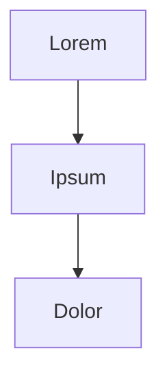
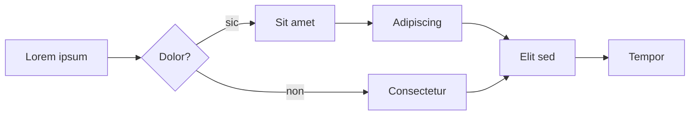

# Lorem Ipsum Dolor

Sit amet consectetur — Q3 2026

## Lorem ipsum

Lorem ipsum dolor sit amet, consectetur adipiscing elit. Sed do eiusmod tempor incididunt ut labore et dolore magna aliqua. Ut enim ad minim veniam, quis nostrud "exercitation ullamco" laboris nisi ut aliquip ex ea commodo consequat -- duis aute irure dolor in reprehenderit in voluptate velit esse.

Excepteur sint occaecat cupidatat non proident, sunt in culpa qui officia deserunt mollit anim id est laborum. Curabitur pretium tincidunt lacus, nulla gravida orci a odio... nullam varius turpis et commodo pharetra.

## Dolor sit amet

### Consectetur

Integer in mauris eu nibh euismod gravida. Duis ac tellus et risus vulputate vehicula. Donec lobortis risus a elit. Etiam tempor, ut ullamcorper ligula eu tempor congue, eros est euismod turpis, id tincidunt sapien risus a quam. Maecenas fermentum consequat mi, as indicated in § 4.2 of lorem ipsum.

### Adipiscing

Nunc nec neque. Phasellus leo dolor, tempus non, auctor et, hendrerit quis, nisi. Curabitur ligula sapien, tincidunt non, euismod vitae, posuere imperdiet, leo.

## Tabula

| Lorem | Q2 | Q3 | Ipsum |
|---|---:|---:|---:|
| Dolor sit | 0 | 0 | 0 |
| Amet consectetur | 5 | 2 | — |
| Adipiscing elit | 91 % | 96 % | 95 % |
| Sed do eiusmod | 82 % | 88 % | 100 % |

## Elenchus

1. Lorem ipsum dolor sit amet, consectetur adipiscing elit.
2. Sed do eiusmod tempor incididunt ut labore et dolore magna aliqua.
3. Ut enim ad minim veniam, quis nostrud exercitation ullamco.

Duis aute irure dolor in reprehenderit in voluptate velit esse cillum dolore eu fugiat nulla pariatur.

## Formula

Lorem ipsum $R = P \times S$, ubi $P$ dolor et $S$ amet (1–5). Consectetur

$$
R_{res} = R \cdot \prod_{i=1}^{n} \left(1 - e_i\right), \qquad 0 \le e_i < 1
$$

ubi $e_i$ adipiscing elit $i$.

## Diagrammata

## Tabula lata

| Dies | Locus | Auctor | Res | Nota | Gradus | Actio | Dominus | Terminus | Status |
|---|---|---|---|---|---:|---|---|---|---|
| 02/07 | Lorem 4 | J. Pérez | Ipsum dolor | Sit amet consectetur | 4 | Adipiscing elit sed do | Lorem ipsum | 03/07 | Clausum |
| 16/07 | Ipsum B | M. Díaz | Dolor sit | Amet | 1 | Nulla | — | — | Clausum |
| 05/08 | Dolor E | J. Pérez | Sit amet | Consectetur elit | 3 | Sed do eiusmod tempor | Ipsum dolor | 06/08 | Clausum |
| 21/08 | Amet | A. Ruiz | Consectetur | Adipiscing elit sed | 2 | Tempor incididunt ut | Dolor sit | 30/08 | Apertum |
